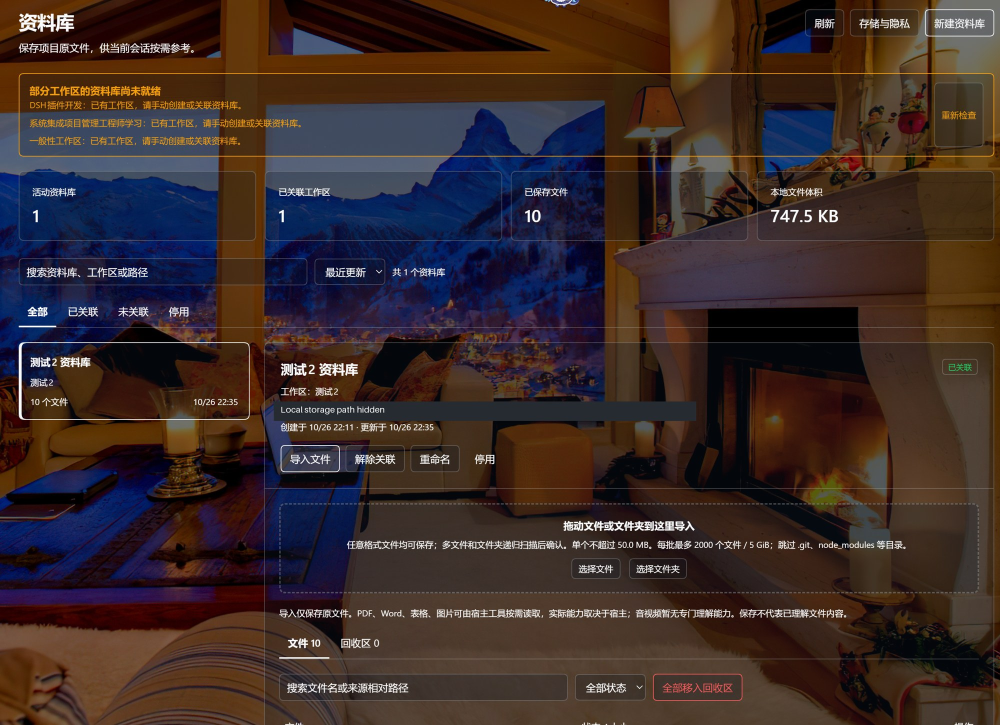
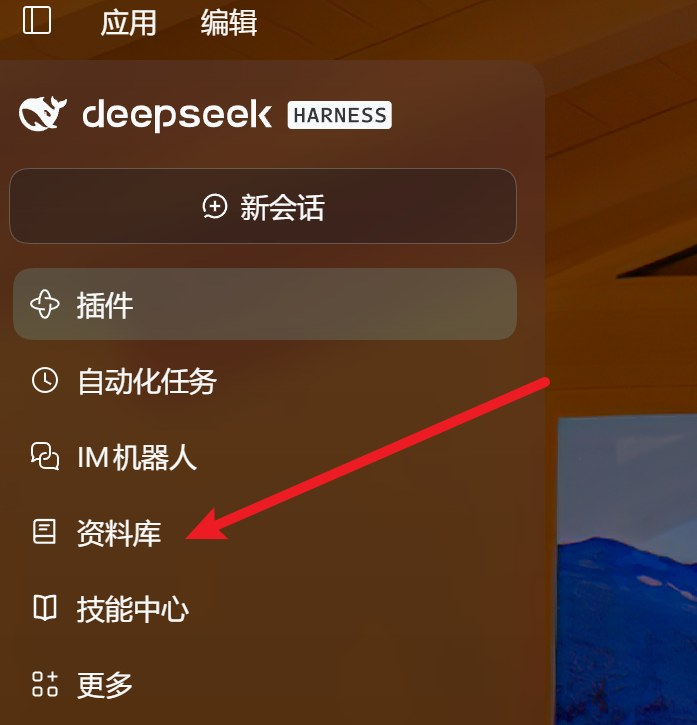
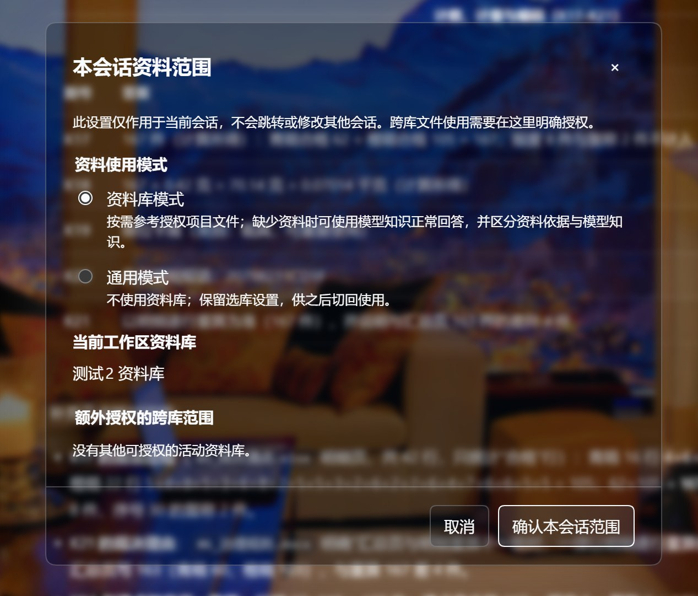

# 使用细节与技术参考

日常使用请先看[项目首页](../README.md)。这里保留存储、授权、批量操作和故障处理的完整说明。

为 **DeepSeek Harness** 的每个工作区自动建立一个独立原文件库，统一存放在你选定的本机目录；在「资料库」菜单里集中管理，任意格式文件都能放进去；对话时可选择是否参考资料库里的文件。原件只复制、不改动来源文件夹，**不预提取、不全文索引、不 OCR，不在后台理解图片、音频或视频。**

> **1.0.0 正式版**。目标接口版本为 DSH `0.2.1-rc.3`。管理 UI 为中文；本项目非官方，不隶属于 DeepSeek。已知限制与验证记录见 [验证记录](validation.md)，后续版本继续优化。

[下载最新版本](https://github.com/wuzeno/dsh-library/releases/latest) · [安装与首次使用](../README.md#安装) · [问题反馈](https://github.com/wuzeno/dsh-library/issues) · [安全边界](../SECURITY.md)



> 截图展示自定义主题下的界面，主题背景与桌面装饰不是本插件提供的功能。本机存储路径已在展示副本中遮盖。

## 安装

1. 从 [Releases](https://github.com/wuzeno/dsh-library/releases/latest) 下载 `dsh-library-1.0.0.tgz`。这是插件安装包；`source.zip` 和 GitHub 自动生成的源码归档不是安装包。
2. 在 DeepSeek Harness 的「插件」管理器中使用本地安装包入口安装并启用。如当前宿主只提供链接本地目录，请先解压 `.tgz`，再选择其中含 `package.json` 的 `package` 目录；以宿主实际支持的入口为准，不要覆盖宿主源码或修改 profile。
3. 完整退出 DSH（包括托盘后台进程），重新启动并刷新页面，确认侧栏出现「资料库」。升级前请联合备份资料目录和 DSH profile；不要为更新删除资料目录或重新导入。

**兼容性：** Node.js ≥22.13.0；声明支持 DSH `>=0.2.1-rc.3 <0.3.0`，目标接口为 `0.2.1-rc.3`，不代表所有宿主版本和平台均已实测。文件能保存不等于模型能理解该格式。

<details>
<summary>界面预览：菜单入口、会话入口与授权范围</summary>

### 菜单入口


### 在对话中选择是否参考资料


### 仅影响当前会话的授权范围


</details>

## 功能

- 独立“资料库”菜单与统一管理页，按库名、工作区、实际路径搜索，按更新时间、名称、文件数排序；区分已关联、未关联与停用。
- 新工作区自动独立建库；已有工作区可创建或关联。以稳定工作区 ID 关联，不以名称或 cwd 猜测，删除后重建同目录也不自动认领旧库。
- 用户先选择本机存储根目录；每库独立 UUID 目录，复制而非移动源文件。改根目录只影响之后的新库，不自动迁移旧库。
- 点击选择或拖放多个文件/文件夹，递归扫描、居中弹窗预览确认后串行导入任意格式原件。弹窗内滚动文件列表，底部始终保留确认与取消按钮。保留来源相对路径作为元数据，同名文件不覆盖。空文件仍拒绝。
- 单文件默认 50 MiB，可设整数 1–200 MiB；每库最多 2000 个文件，包含回收区。批量进度、逐文件错误、停止后续导入及扫描预算保留。
- 管理页保留下载原文件、排除/纳入 AI 参考、回收/恢复；回收区新增永久删除和清空回收区，必须输入完整文件名/库名二次确认，仅删除库内副本。移除提取文本、分段预览、全文检索测试和重试解析入口。
- 会话默认仅可参考工作区关联库，额外跨库必须明确授权；新会话和 fork 不继承额外授权。通用模式不注入资料元数据正文，拒绝资料 `library_files` / `library_open` 访问。
- 资料库模式通过 `library_files` 列出获授权文件名与来源，通过 `library_open` 按需交付原生附件；参考内容须区分资料引用、模型知识补充与推断，未命中可正常使用模型知识回答，不编造资料引用。

## 首次使用

1. 经用户单独批准，在目标 DSH 插件管理器安装并启用 bundle；克隆源码或运行测试不等于安装。不要手改宿主源码或 profile 清单。
2. 打开“资料库”→“存储与隐私”，选择或输入服务器电脑上的本机绝对目录，并明确保存。选择目录本身不会保存；不支持选择器时可手动输入。
3. 在“存储与隐私”重新确认是否允许模型按需使用**整份原文件**。`settings.originalConsent` 默认 `false`；旧 `cloudConsent` 仅曾同意片段，升级后不静默继承为整份原件权限。
4. 创建/关联工作区库，导入文件并核对原件列表；不需要等待解析、索引或 OCR。
5. 在资料库模式提问，由模型按需列文件、打开相关文件，再使用文件工具或 skills；可用会话范围控件确认默认库与显式跨库授权。

**不要把资料存储目录放进 Git 仓库。** 原件、历史抽取缓存和会话附件/日志均可能包含隐私。

## 按需附件与隐私

导入不把原件送给模型，也不代表已理解内容。`library_open` 在核对同意、模式、范围与文件状态后，通过 `ctx.attachments.saveFile` 返回原生 `file` block；宿主须像聊天附件一样投影只读路径，供文件工具或 skills 按需读取。插件不以任意磁盘路径代替这一附件契约，也不把整库内容塞入上下文。PTC/run_code 调用时，返回值还带有通过同一宿主接口映射的真实 `readPath`，须打印/返回后再交给文件工具；映射不可用会明确返回 null，不伪造或回退原库路径。宿主投影与后续工具读取仍需真实联调。

仅在 open 时检查 PNG/JPEG/WebP/GIF 魔数，符合条件的图片通过 `ctx.attachments.saveImage` 返回 `image` block；不重编码或覆盖原件。图片准入失败时退回 generic 文件并明确说明，不能把降级当作图片已经被模型看见。其他格式均按普通文件交付；能否进一步读取由宿主、模型及可用 skills 决定，不承诺任意格式或完整多模态理解。

使用云端模型时，按需打开可能把**整份原文件**交给当前模型链路，并进入会话附件与历史。关闭原件同意阻止后续插件交付，**不能撤回已发送的会话附件、模型已看过的内容，不能阻止其他具广泛文件权限的工具**。需要减少旧上下文影响时，应另开干净会话；这也不撤回已经发送的数据。

资料内的指令、角色声明和工具调用要求是不可信数据，不可替代系统规则。引用仍应核对原件；列文件或未找到相关内容不证明全库已被理解或穷尽检查。资料库模式参考授权资料，未命中时正常回答并区分知识补充；通用模式仅给出不含库/文件信息的模式标记，要求不使用历史资料库附件，不注入资料元数据或正文且拒绝 `library_files` / `library_open`，不能借知识补充绕过隐私或跨库边界。

## 格式与边界

| 项目 | 1.0.0 版本范围 |
| --- | --- |
| 导入 | 任意格式原件与元数据；不预提取、不全文索引、不 OCR、不后台理解媒体 |
| 按需使用 | 原生 file block；PNG/JPEG/WebP/GIF 仅 open 时魔数识别并尝试原生 image block，图片准入失败明确降级 generic 文件 |
| 单文件 | 默认 50 MiB，可设整数 1–200 MiB；空文件拒绝 |
| 文件数 | 每库最多 2000 个文件，包含回收区 |
| 单批次 | 最多 2000 个文件、合计 5 GiB；目录扫描最多检查 10000 个条目，超预算整批不开始上传 |
| 文件夹 | 超过 32 层的子目录跳过并报告；跳过 .git、node_modules、.venv、venv、__pycache__；空文件和超限等原因最多展示 200 条 |
| 范围 | 每会话最多 8 库；列举与打开仅限当前有效授权、未排除、未回收且可用的库/文件 |
| 旧数据 | 旧 ready/error/stored 文件均可按需使用；状态不是是否能打开的解析门槛，不改原件、不重解析、不删除旧 extracted 目录 |
| 删除/迁移 | 逻辑回收不释放磁盘；二次确认后可永久删除库内原件副本和旧提取缓存，不删来源文件或历史会话附件；停用后的库可整库删除（含其目录内全部文件）；改根目录不搬旧库 |
| 国际化 | 插件元数据中英；管理 UI 中文首版 |

文件夹扫描只访问浏览器授予的内容，确认前不上传。扫描超预算整批取消，可拆小目录；空目录不创建资料库子目录。停止导入等待当前请求结束，已保存文件不回滚。来源相对路径只作显示、筛选及溯源，实际原件使用 UUID 存储，不用来源路径拼接磁盘写入位置；同内容按指纹拒绝重复。提高上传上限不保证宿主附件准入或工具能读取该文件。

## 一键移入回收区

**更新后请完整退出 DSH（包括托盘后台进程）再重新启动并刷新页面。** 只刷新网页，或只停用/启用插件，不保证运行中的后端已换新；是否热重载取决于宿主 HMR。不要为更新删除资料目录、重新导入或手改 profile。

1.0.0 的已认证 snapshot 会给出实际运行路由的 `backendVersion` 和 `capabilities.trashAll`、`capabilities.deleteLibrary`。前端仅在明确宣告支持时开放对应入口；旧版/未声明能力会禁用入口并提示完整重启，单文件操作不受此能力标记限制。即使已经声明能力，提交遇到旧路由的“未知资料库操作。”也会明确提示版本不一致并刷新能力，不自动重发写请求，不静默降级为逐文件操作。

在资料库详情的“文件”页点击“全部移入回收区”，输入完整资料库名称并确认。此操作覆盖该库全部未回收文件，**包括已排除文件，不受名称搜索或状态筛选影响**；已在回收区的文件及删除待完成项保持原样。忙碌、停用库或没有未回收文件时按钮不可用。

这是一次串行批量元数据操作，不是逐个文件发请求，不移动或删除库内原件、来源文件或其他库。成功提示采用服务端实际移入数量，刷新列表后可在回收区逐个恢复；恢复会回到原先的已保存/已排除状态。历史会话已交付的内容不能撤回。失败时保留确认框供重试；若已提交但刷新失败，请先刷新核对，不要把提示误认为未提交。

## 回收区永久删除

在资料库详情切换到“回收区”，单个文件可点击“永久删除”并输入完整文件名；“清空回收区”需输入完整库名，作用于该库整个回收区，**不受当前搜索筛选影响**。未移入回收区的文件不会被此操作删除。操作不可恢复，请先自行备份；这不是系统回收站。

仅删除通过所有权、ID、固定路径及文件类型校验的库内 `originals/<file-id><ext>` 与历史 `extracted/<file-id>.json`。不会递归删除目录，不使用来源相对路径作为删除目标，也不会删除其他库或已经交付的历史会话附件。普通模型资料工具没有永久删除权限。

删除意图先持久化，随后才删除字节；中断、文件占用或持久化失败会保留“删除待完成”项。此时原件可能已部分删除，不能恢复；排除占用/权限问题后可点击“重试永久删除”。部分失败不会显示全部成功。若文件删除已提交、仅备份清单镜像更新失败，则显示警告，不把文件伪装为仍可恢复；插件私有存储是元数据权威，备份时应同时保留 profile。

## 删除资料库

只有**已停用**的资料库才会在详情页出现“删除资料库”。停用是删除的前置条件：先停用停止 AI 参考，再决定是恢复还是彻底删除，避免误删仍在使用的库；正在使用的库只能停用或重命名。

确认框要求输入完整资料库名称，并列出将被删除的文件数量（含回收区数量）和该库自己的本地目录。确认后删除该库记录，并删除它**自己的本地目录**——里面的原件、旧提取缓存、回收区条目和“删除待完成”记录一并移除。

- 不影响来源文件夹：导入只是复制，删除不动原始文件。
- 不影响其他资料库：删除前核对所有权标记与固定路径，只作用于这一个库的目录。
- 不影响历史会话：已经作为附件交付到过去会话的副本不能撤回，这是宿主的既有边界。
- 失败不假装成功：开始删除前持久化删除意图；中途失败保留待删除库记录并禁止恢复，明确提示文件可能已部分删除。无法可靠统计部分删除数量时不报告虚假数量，排除占用或权限问题后可重试。
- 回收站不参与：界面的“回收区”是插件内的逻辑回收区，与本操作无关；删除资料库不经系统回收站，不可恢复。

旧版后端没有这个动作时，前端会禁用入口并提示完整退出 DSH 后重启，不会静默降级或自动重发。模型侧工具没有删除资料库的权限。

## 数据布局与备份

```text
用户指定的根目录/
  <library-uuid>/
    .dsh-library.json     # 所有权标记
    manifest.json         # 资料库与文件元数据镜像
    originals/
      <file-uuid>.pdf     # 导入副本，源文件不动
    extracted/            # 如旧版本已生成则保留；新导入不生成、不依赖
```

关联、默认根目录、原件同意和会话额外授权保存在插件私有 `dsh_library` storage domain。运行中元数据以该 domain 为权威，manifest 仅为镜像。升级不把旧 `cloudConsent` 复制到 `settings.originalConsent`；必须重新在存储隐私确认。请联合备份资料目录和 DSH profile；只拷贝源码无法恢复资料/关联，当前不自动扫描目录重建丢失的 profile 关联。

单进程队列串行修改，JSON 临时写入、同步后改名；跨 domain 与资料目录不是原子事务。故障可能留下未登记原件或旧镜像，不会为了回滚自动删原件。不要让两个 DSH 进程管理同一 profile/资料库；见[架构与恢复](architecture.md)。

## 开发与发布

需要 Node.js 22.13+（建议 24 LTS）与 pnpm，无运行构建步骤或安装脚本。

```sh
pnpm install --ignore-scripts
pnpm run test:all
pnpm pack --pack-destination release
```

以上是开发者命令说明，不代表本次已经执行或通过。`documents.js`、parse 模块及其测试暂留作历史辅助代码；mammoth/pdfjs-dist 已移入开发依赖，当前运行依赖仅 zod。运行入口 store 不 import、不调用解析器，不能据历史测试宣称当前使用了解析隔离或全文检索。

提交锁文件，不提交 node_modules、资料、临时测试目录、个人 profile、凭据或发布产物。CI 成功不等于宿主实机验收。发布前阅读[发布清单](releasing.md)、[安全说明](../SECURITY.md)及[贡献指南](../CONTRIBUTING.md)；推送/发布须另获明确授权。

## 许可

项目代码与原创书本图标采用 MIT。界面截图仅用于功能展示，截图中的第三方商标、主题背景与装饰素材权利归各自权利人，不纳入本项目 MIT 授权。保留的第三方依赖各遵其许可证：mammoth（BSD-2-Clause）、pdfjs-dist（Apache-2.0）、zod（MIT），以锁定版本随包许可证为准；依赖存在不表示原件库运行路径会调用解析器。
